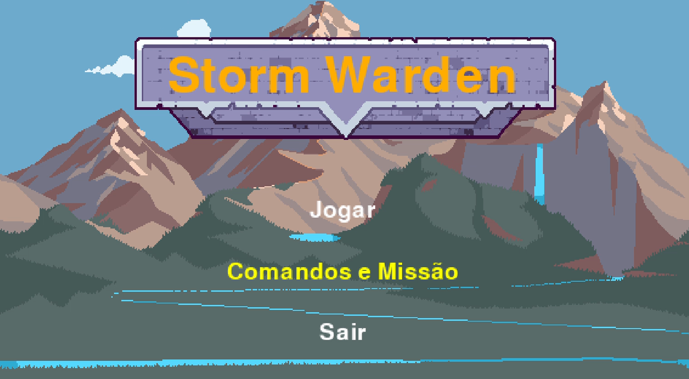
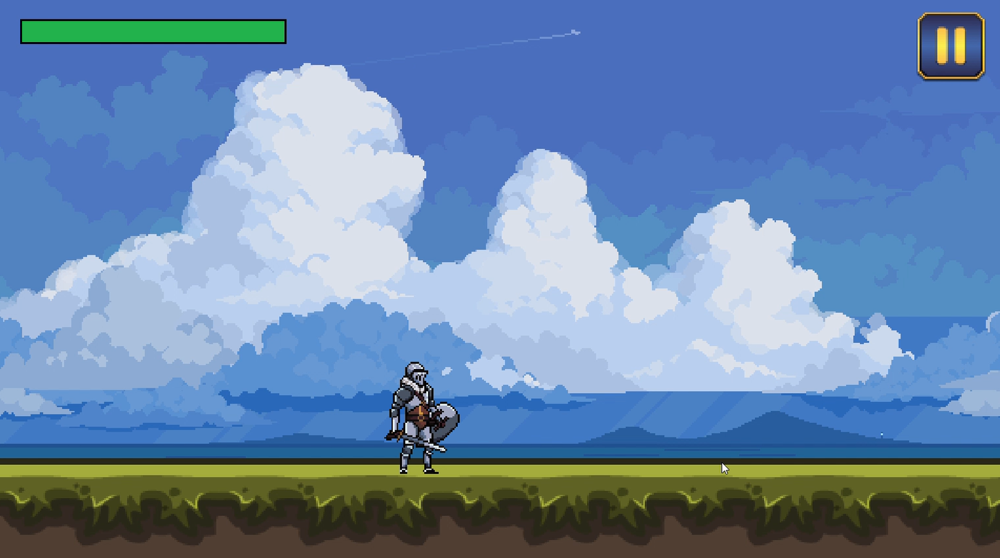
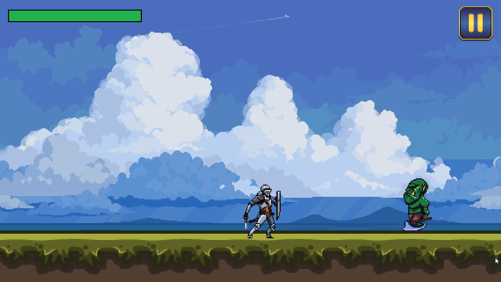
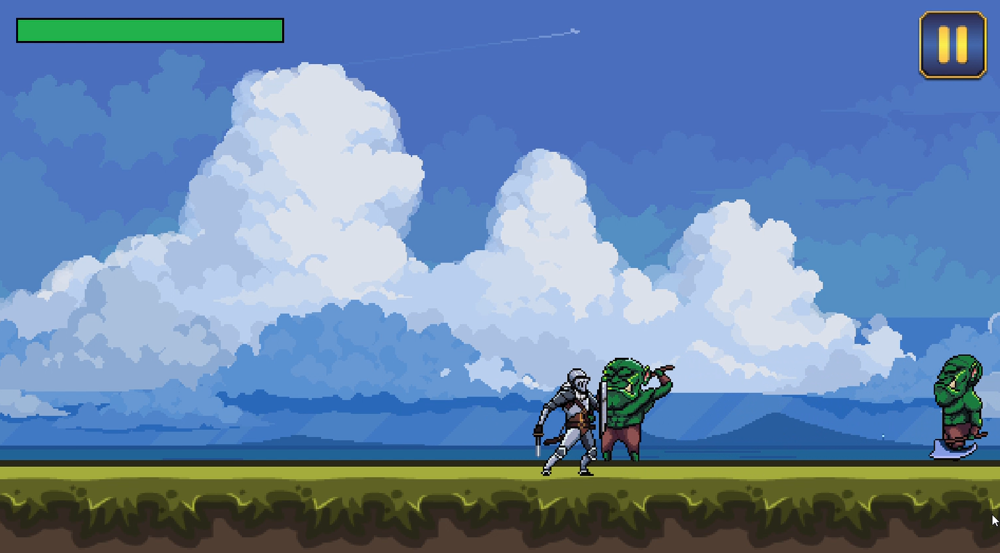
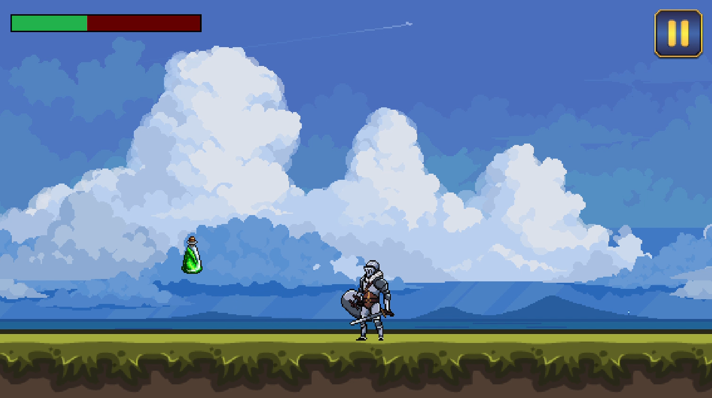
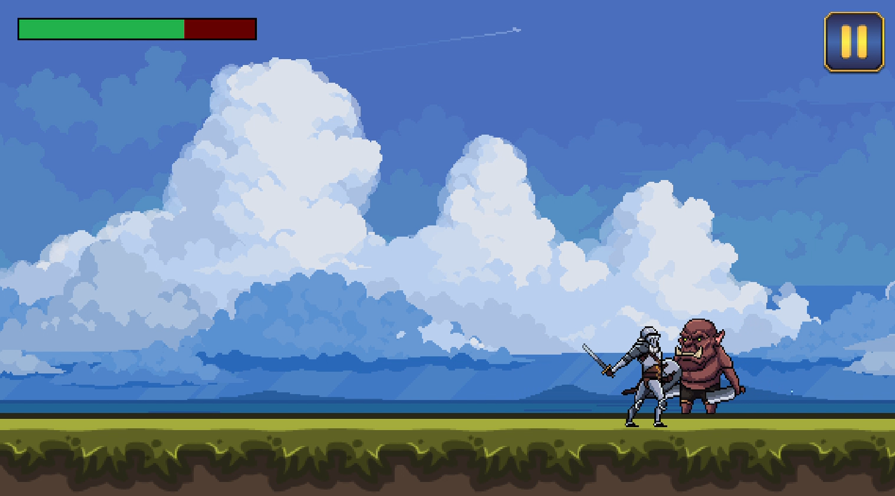

# Storm Warden (Demo) ⚡

Uma demonstração de jogo 2D desenvolvida como projeto acadêmico para praticar conceitos fundamentais de desenvolvimento de software e lógica de programação em Python.

## 👥 Créditos e Atribuições

Todos os *assets* e *sprites* utilizados no projeto possuem licença **CC0 (Domínio Público)**. 
Para conferir os sites e autores de onde os recursos foram retirados, acesse [Créditos](CREDITS.txt).

Compatibilidade: Desenvolvido exclusivamente para ambientes desktop (Testado em Windows). 
Requer o interpretador Python instalado para execução a partir do código-fonte.

---

## 🎯 Sobre o Projeto

O objetivo principal deste projeto foi aplicar na prática conceitos essenciais de programação através da criação de um jogo interativo. Durante o desenvolvimento, foram explorados e implementados:

* **Programação Orientada a Objetos (POO):** Estruturação de entidades do jogo, classes e métodos.
* **Desenvolvimento 2D com Pygame:** Manipulação de cenários, camadas em parallax e mecânicas de plataforma.
* **Lógica de Jogos:** Loop principal de renderização, tratamento de eventos e colisões.

> **Status do Projeto:** Concluído. O projeto cumpriu todos os requisitos acadêmicos solicitados e encontra-se finalizado.

---

## 🛠️ Tecnologias Utilizadas
* **IDE:** Pycharm 2026.1
* **Linguagem:** Python 3.12
* **Biblioteca:** Pygame 2.6.1

---

## Imagens da Demo

---

## 🚀 Como Executar o Projeto

1. Clone este repositório:
   git bash

2. o comando PyInstaller --onefile main.py 
O PyInstaller vai gerar uma build do projeto na pasta dist.
O argumento --onefile vai fazer com que toda a compilação fique em um só arquivo exe.
O argumento main.py é o script inicial do projeto.

3. Depois do comando, ao teclar ENTER, o compilador vai fazer o trabalho dele, isso
pode demorar alguns minutos. 

4. Se tudo der certo, você terá dentro da pasta do projeto, uma pasta chamada dist.
Nela terá o executável compilado do seu projeto.

5. Mas ele não vai funcionar, pois o jogo tem imagens e sons, esses
arquivos que não são códigos (imagens e sons) não são compilados pelo PyInstaller.
Então é necessário que você copie e cole a pasta assets ao lado do arquivo exe.
Por que ao lado? Porque a localização da pasta assets é ao lado do script main.py
que é onde o projeto inicia.
